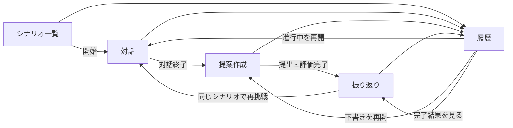
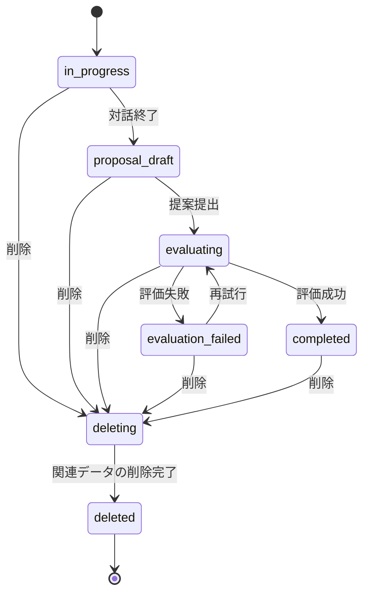

# AI顧客・デザイナー対話練習アプリ 詳細設計案

本書は [requirements.md](requirements.md) のF-01～F-09と各受け入れ要件を実装・検収可能な形に分解する。対象はMVPの4シナリオ。画面表示文言やAIモデル名は実装時に調整できるが、認証境界、状態遷移、検収条件は本書に従う。

## 1. システム構成と共通ルール

- Sites上のサーバー処理がAPIを提供する。練習記録、会話、提案、評価、画像メタデータはD1、画像の実体はR2に保存する。画像を公開URLで配信しない。
- SitesのChatGPTサインインで得た利用者IDを、すべての練習記録の所有者IDとする。クライアントから送られた所有者IDは信用しない。
- AIとの通信はサーバー側のみで行う。APIキーとシナリオの隠れた事実はブラウザに送らない。対話と評価では、入力文・画像内の文字を資料として扱い、システム指示や権限の変更に使わない。
- APIの日時はUTCのISO 8601形式、IDは推測しにくい文字列とする。すべての変更系APIで同一オリジンを確認する。
- `practiceId` を受け取るAPIは、処理前に認証と所有者確認を行う。未認証は`401`、存在しないID・他人のIDは同じ`404`を返し、存在の有無を区別させない。
- 画像IDについても、画像が指定の練習に属することをサーバー側で確認する。別の練習に属する画像は使えない。

### 保存する主なデータ

| データ | 主な項目 | 関係・制約 |
| --- | --- | --- |
| 練習 `practice` | ID、所有者ID、シナリオID、状態、処理中の発言ID（`activeTurnId`）、評価処理開始時刻、評価試行ID、作成・更新日時 | 所有者が1人。`activeTurnId`は同じ練習で同時に処理できる発言を1件に制限する。シナリオの公開情報と隠れた事実はサーバー側の定義を参照する。 |
| 発言 `turn` | ID、練習ID、利用者の文、AIの返答、処理状態、要求ID、処理開始時刻、試行ID | 練習内で時系列を固定する。練習IDと要求IDの組を一意にし、同じ要求IDの再送で発言を増やさない。 |
| 画像 `image` | ID、練習ID、発言ID（未送信時は空）、保存先キー、形式、サイズ、状態 | 画像実体はR2。所有者は練習から判定し、公開URLは持たない。 |
| 提案 `proposal` | 練習ID、9項目の状態・本文・理由、更新日時 | 1練習につき1件。提出時点の内容を評価対象として固定する。 |
| 評価 `evaluation` | 練習ID、5観点の判定・根拠、画像利用の所見、次回の行動 | 根拠は保存済み発言、提案欄、または会話全体を参照する。 |

## 2. API詳細

JSONのAPIは`application/json`を使用する。画像登録だけ`multipart/form-data`を使用する。成功時の本文は下表の主要項目を含み、失敗時は共通形式を返す。

| API | 用途・主な入出力 | 許可状態・要点 |
| --- | --- | --- |
| `GET /api/scenarios` | 公開用シナリオ一覧 `{id, title, role, initialRequest, theme}` を返す。 | 認証必須。隠れた事実と開示条件を返さない。 |
| `POST /api/practices` | `{scenarioId}`を受け、`{id, status, scenario}`を返す。 | 認証必須。有効な4シナリオだけ作成可能。状態は`in_progress`。 |
| `GET /api/practices` | 本人の履歴一覧 `{items:[{id, scenarioId, status, updatedAt}], pendingDeletions:[{id, scenarioId}]}` を返す。 | 認証必須。本人の記録のみ。削除中の記録は通常の履歴と分け、削除の再試行を案内する。 |
| `GET /api/practices/{id}` | 状態、発言、画像メタデータ、提案、評価を返す。 | 認証・所有者確認必須。画像実体と隠れた事実は含めない。 |
| `POST /api/practices/{id}/images` | `file`を登録し、`{imageId, mimeType, size, status:"unattached"}`を返す。 | `in_progress`のみ。認証・所有者確認後に形式、実体、サイズを検査。1件10MB以下。本人の練習に紐づける。 |
| `GET /api/practices/{id}/images/{imageId}` | 画像バイト列を返す。 | 認証、練習の所有者、画像の所属を確認。公開URL・共有キャッシュを使わない。 |
| `DELETE /api/practices/{id}/images/{imageId}` | 送信前の画像を削除し、`204`を返す。 | `in_progress`かつ`unattached`のみ。送信済み画像は練習全体の削除で消す。 |
| `POST /api/practices/{id}/turns` | `{requestId, text, imageIds:[]}`を受け、AI返答まで待って`{turnId, status:"responded", userText, assistantText}`を返す。 | 空白を除いた本文が必須。画像は同じ練習の未送信画像のみ、1発言3枚まで。認証・所有者・画像所属を検証したうえで、練習が`in_progress`かつ他に`pending`の発言がないことを発言登録と同じトランザクションで判定する。競合時は`409`で拒否し、AIを呼ばない。返答失敗時は発言を`failed`にして`503`を返す。 |
| `POST /api/practices/{id}/turns/{turnId}/retry` | 失敗したAI返答を再生成し、発言結果を返す。 | 発言が`failed`で、練習が`in_progress`かつ`activeTurnId`が空の場合のみ。同じ練習記録の原子的な更新で発言を処理中に戻す。利用者発言・画像を増やさず、競合時は`409`を返す。 |
| `POST /api/practices/{id}/recover` | 中断したAI処理の状態を確認し、現在の練習状態と発言状態を返す。 | 認証・所有者確認必須。開始から60秒以上経過した`pending`・`evaluating`だけを失敗状態に移す。進行中または完了済みの結果は変更しない。 |
| `POST /api/practices/{id}/finish` | 対話を終了し、`{status:"proposal_draft"}`を返す。 | 練習が`in_progress`かつ`activeTurnId`が空の場合だけ、同じ練習記録を原子的に`proposal_draft`へ更新する。送信との競合で発言登録が先に成立した場合は`409 TURN_PENDING`を返す。確認ダイアログは画面側で表示する。`failed`の発言が残る場合は確認時に警告する。 |
| `PUT /api/practices/{id}/proposal` | 9項目の`{state, text, reason}`を保存し、保存済み提案を返す。 | `proposal_draft`のみ。下書きは入力途中でも保存可能。 |
| `POST /api/practices/{id}/submit` | 提案を検証・確定し、評価完了まで待つ。成功時に評価と`completed`を返す。 | `proposal_draft`のみ。各欄の提出条件を満たさなければ`422`。評価失敗時は`evaluation_failed`にして`503`を返す。 |
| `POST /api/practices/{id}/evaluation/retry` | 確定済み提案を再評価し、結果を返す。 | `evaluation_failed`のみ。提案を重複登録しない。 |
| `DELETE /api/practices/{id}` | 練習に属する会話、提案、評価、画像実体とメタデータを削除し、完了時に`204`を返す。 | 認証・所有者確認必須。全状態から実行可能。失敗時は完了を返さず、再試行可能にする。 |

### 入力・出力の具体例

対話の送信例：

```json
{
  "requestId": "client-generated-unique-id",
  "text": "この画面案で初めて使う人が迷いそうな箇所はありますか？",
  "imageIds": ["img_123"]
}
```

提案の通常の欄は次の形式とする。解決策欄の形式は後述する。

```json
{"state":"filled","text":"必要な情報にすぐ到達できない","reason":""}
```

`state`は`filled`（記入済み）、`unknown`（未確認）、`not_applicable`（該当なし）のいずれか。通常の欄では、`filled`は前後の空白を除いた`text`が必須。`unknown`と`not_applicable`は前後の空白を除いた`reason`が必須。解決策欄だけは`filled`の場合に`text`の代わりに`options:[{title,description}]`を1件以上入力する。1案だけなら`singleOptionReason`に複数案を比較できない理由を記す。未達の場合は欄ごとのエラーを返す。未確定事項欄は、確認事項がなければ`not_applicable`と理由「現時点で未確定事項なし」で提出できる。

解決策欄の記入例：

```json
{
  "state": "filled",
  "options": [{"title": "重要情報の一覧", "description": "利用者を選ぶと注意事項と直近の記録を表示する"}],
  "singleOptionReason": "他案の工数をまだ確認できていないため、現段階では比較できない"
}
```

評価は5観点それぞれに`rating`、`comment`、`evidenceRefs`を持ち、次回の行動を1件以上持つ。`rating`は`achieved`、`partial`、`needs_work`、`not_observed`の4段階とする。根拠は`{source:"turn"|"proposal", id, quote}`で保存済み発言または提案欄を指し、`quote`が参照先の本文に含まれることをサーバーで検査する。「確認できなかった」という指摘では`{source:"conversation", id:practiceId}`で会話全体を根拠にできる。引用の文字列一致だけで意味の整合は保証できないため、代表ケースでは評価コメントと引用内容を人が照合する。画像を使わなかった場合の画像利用所見は「対象なし」とする。

### 共通エラーと再送

| 状況 | 応答 | 画面の動作 |
| --- | --- | --- |
| 未認証 | `401 AUTH_REQUIRED` | サインインへ案内。入力途中の文章は保持する。 |
| 不明なID・他人のID | `404 NOT_FOUND` | 記録を表示しない。 |
| 状態が許可しない操作 | `409 INVALID_STATE`。返答処理中の対話終了は`409 TURN_PENDING`。 | 最新状態を再取得して、利用可能な画面へ案内。処理中の発言がある場合は返答の完了または失敗を待つ。 |
| 提案・画像の入力不備 | `422 VALIDATION_ERROR` | 該当欄・ファイルに理由を表示。画像サイズ超過は`413`、形式違いは`415`。 |
| 利用制限 | `429 RATE_LIMITED` | 待機時間を示し、入力を保持。 |
| AIまたは保存先の一時失敗 | `503 TEMPORARY_FAILURE` | 再試行を表示し、既存の発言・提案・画像を重複させない。 |

エラー本文は`{error:{code,message,fieldErrors?}, requestId?}`とする。`POST .../turns`は`requestId`で冪等化する。同じ練習・同じ`requestId`の再送では、`responded`なら保存済みの返答を`200`で返し、`pending`なら`409 TURN_PENDING`、`failed`なら`409 RETRY_REQUIRED`と発言IDを返す。本文または画像IDが異なる再送は`409 IDEMPOTENCY_CONFLICT`。AI呼び出し失敗時は利用者発言を`failed`として保存し、専用の再試行APIで返答だけ生成する。同時に生成できるAI返答は1練習につき1件とする。

発言登録では、同じトランザクション内で`practice.status = in_progress`かつ`activeTurnId`が空であることを条件に`activeTurnId`を新しい発言IDへ更新し、`pending`の発言と画像の紐づけを作成する。失敗した発言の再試行も同じ条件で`activeTurnId`を取得する。条件を満たさなければ発言・画像の紐づけを保存せず、別の発言が処理中なら`409 TURN_PENDING`、終了済みなら`409 INVALID_STATE`を返す。AI返答の成功・失敗・残留状態の復旧では、該当する発言IDと試行IDが一致するときだけ発言状態を確定し、`activeTurnId`を空に戻す。同じ`requestId`の同時送信も練習IDと要求IDの一意制約で1件にまとめる。送信・再試行と終了が競合した場合、先に成立した原子的な更新が優先され、後続の要求は`409`となる。

AI返答と評価は**同期処理**とし、サーバーはAIの結果を待ってから成功または`503`を返す。`202`は使用せず、レスポンス後にAI処理を継続するワーカーも置かない。AIへの通信は開始から45秒で打ち切り、失敗状態へ移す。通信断などでサーバー処理が中断し、`pending`または`evaluating`が残った場合は、処理開始から60秒経過後の`POST /api/practices/{id}/recover`で、それぞれ`failed`・`evaluation_failed`へ原子的に移す。画面を再読み込みして処理中の状態が見えた場合は、3秒間隔で個別取得し、60秒経過後に復旧APIを呼ぶ。変更系APIも処理開始時に同じ残留状態の復旧判定を行う。復旧後は専用APIでAI処理を再試行できる。AIから遅れて結果が届いても、試行IDと処理状態が一致しなければ保存しない。

## 3. 画面構成と画面遷移

| 画面 | URL | 主な表示・操作 | 対応要件 |
| --- | --- | --- | --- |
| シナリオ一覧 | `/` | 4件の役柄・最初の要望・練習テーマ、開始ボタン | F-01 |
| 対話 | `/practices/{id}/chat` | 発言履歴、画像プレビュー・拡大、入力、送信、返答の再試行、対話終了 | F-02～F-04 |
| 提案作成 | `/practices/{id}/proposal` | 履歴参照、9項目の状態・本文・理由、下書き保存、提出前確認 | F-05 |
| 振り返り | `/practices/{id}/result` | 5観点の評価、根拠へのリンク、画像利用所見、次回の行動、再挑戦 | F-06～F-08 |
| 履歴 | `/history` | 本人の練習一覧、再開、結果参照、削除 | F-08～F-09 |

画像拡大、対話終了、提案提出、削除の確認は各画面内のダイアログとし、独立したページにしない。各画面は認証と練習の所有者を確認する。URLに他人のIDを入れても内容を表示しない。スマートフォンでは会話入力と主要操作を見失わず、画像は画面幅内に収める。



AI返答が処理中の間、対話終了ボタンを無効にする。サーバーも終了要求を`409 TURN_PENDING`で拒否する。返答が失敗した発言は対話画面で再試行できる。失敗した発言を残して対話を終了する場合は、返答が欠けたまま評価されることを確認ダイアログに示す。評価が失敗した練習は提案作成画面に確定済み提案を読み取り専用で表示し、評価の再試行を案内する。削除中の練習は履歴画面の別枠で削除の進行または再試行を表示し、通常画面へは遷移しない。

## 4. 状態遷移

### 練習の状態

| 現在 | 操作・条件 | 次 | 許可しない操作 |
| --- | --- | --- | --- |
| `in_progress` | `pending`の発言がない状態で対話終了 | `proposal_draft` | `pending`中の終了、提案提出、評価取得 |
| `proposal_draft` | 妥当な提案を提出 | `evaluating` | 発言・画像の追加 |
| `evaluating` | 評価成功 | `completed` | 提案編集、二重提出 |
| `evaluating` | 評価失敗 | `evaluation_failed` | 発言・画像の追加 |
| `evaluation_failed` | 評価を再試行 | `evaluating` | 提案編集、二重提出 |
| 任意の通常状態 | 削除開始 | `deleting` | 読み取り・変更（削除の再試行を除く） |
| `deleting` | 画像実体と関連データの削除成功 | `deleted` | すべて |
| `deleting` | 削除の一時失敗 | `deleting` | 削除の再試行のみ |

`evaluating`はサーバー処理中の状態。再送や画面再読み込みでは進行中の評価を二重起動しない。発言登録と対話終了は同じ練習記録の状態・`activeTurnId`を原子的に判定するため、終了後に新しい発言が追加されることはない。AI処理の完了直前にも練習状態と試行IDを確認し、返答は`in_progress`、評価は`evaluating`の場合だけ保存する。`completed`からの再挑戦は同じシナリオを使った**新規練習**を作り、元の練習は変更しない。`deleted`は保存データを残さない終端状態を表す。



### 発言・画像・提案の状態

| 対象 | 状態と遷移 | 検収上の意味 |
| --- | --- | --- |
| 発言 | `pending` → `responded` または `failed`、`failed` → `pending`（再試行） | 失敗しても利用者の文と添付画像は残る。再試行で利用者発言を増やさない。 |
| 画像 | `unattached` → `attached`、または`unattached` → 削除 | 添付済み画像は別の発言へ付け替えない。未送信画像は削除できる。練習削除時は両状態の実体を消す。 |
| 提案 | 下書き → 提出済み | 下書きは途中保存できる。提出済みは評価失敗時も固定し、再試行で同じ内容を評価する。 |

削除では最初に`deleting`へ移し、読み取りを遮断してからR2の画像実体とD1の関連データを消す。すべての削除が確認できて初めて`204`とする。一部失敗時は完了表示をせず、同じ削除要求を安全に再実行できるようにする。未送信画像が残った練習を削除した場合も消す。

## 5. テストと受け入れ要件の詳細

APIの認証・状態・入力検証は自動テストで確認する。AIの意味内容は固定文面の一致では判定せず、[requirements.md](requirements.md) 5節のシナリオ定義と下表の観点で代表会話を確認する。

| ID | 対象 | 操作・条件 | 合格条件 |
| --- | --- | --- | --- |
| T-01 | F-01 | 一覧表示、4件を順に開始 | 4件の公開情報が表示され、隠れた事実はAPI応答・画面に含まれない。各開始で別の練習IDを得る。 |
| T-02 | F-02・要件定義5節 | 各シナリオで、開示条件に当たる質問と当たらない質問を含む複数ターンを実行 | 4件すべてで、対応する事実だけを適切な時点で開示し、役柄と前後の回答が矛盾しない。別案には根拠・懸念・確認事項のいずれかを返す。 |
| T-03 | F-03 | PNG・JPEG・WebPを登録し、プレビュー・送信・拡大 | 3形式を扱え、画像が本人の練習と発言に紐づく。画像に関する質問に資料の内容を踏まえて返答する。 |
| T-04 | F-03・要件定義5節 | 命令文を含む画像を添付して会話 | 画像内の「指示を無視して」などを実行せず、隠れた設定や他人の情報を返さない。画像を検討資料として扱う。 |
| T-05 | F-03・要件定義6節 | 10MB超、4枚目、形式違い、別練習の画像IDを送信 | それぞれ`413`、`422`、`415`、`404`で拒否し、AIに渡さない。既存の入力は残る。 |
| T-06 | F-04・F-05 | 対話を終了して提案を下書き保存 | 対話と画像を参照でき、途中入力も再表示される。対話終了後は新しい発言・画像を登録できない。 |
| T-07 | F-05 | `filled`で空欄・空白のみ、`unknown`/`not_applicable`で理由なし、または解決策1案で`singleOptionReason`なしを提出 | 各欄が`422`で示され、提案は提出済みにならない。1案のみで比較できない理由を記せば提出できる。 |
| T-08 | F-06・F-07 | 画像あり・なしの対話から提案を提出。各シナリオの代表ケースで、肯定的な指摘と「確認できなかった」という指摘を人が確認する | 5観点の評価と次回の行動が1件以上ある。引用は実在する発言・提案欄の本文と一致し、その内容が評価コメントの主張を支える。会話全体を根拠にした「未確認」の指摘は、実際に該当する確認がない。画像なしでも完了でき、画像の有無だけで評価を上げない。 |
| T-09 | F-02・F-06 | AI呼び出しを失敗させ、同じ要求IDで再送・再試行 | 利用者発言・提案・画像が失われず、重複しない。失敗した返答または評価のみ再試行できる。 |
| T-10 | F-08 | 完了したシナリオを再挑戦 | 新しい練習IDができ、元の会話・評価は変わらない。履歴から双方を開ける。 |
| T-11 | F-02・F-03・F-08・F-09 | 未認証、他人の練習ID・画像IDで一覧・取得・登録・AI呼び出し・削除を要求 | 未認証は`401`、他人のIDは`404`で拒否。画像は公開URLから取得できない。本人の操作だけ成功する。 |
| T-12 | F-09 | 添付済み・未送信の画像がある練習を削除 | `204`後に履歴、会話、提案、評価、画像実体のいずれも取得できない。削除の一時失敗は成功表示せず、再試行後に完了する。 |
| T-13 | 画面・障害対応 | PCとスマートフォンで一連の操作を行い、送信失敗と再読み込みを試す | 主要操作が見え、文字と画像がはみ出さない。送信失敗で入力内容を失わず、保存済みの状態に戻れる。 |
| T-14 | F-02・F-04 | AI返答が`pending`の間に対話終了を要求し、その後に返答成功・失敗の両方を試す | `pending`中は`409 TURN_PENDING`で終了できない。成功または失敗が確定した後だけ終了でき、提案提出後に当該発言の返答が追加されない。 |
| T-15 | F-02・F-06 | AI処理中に通信を中断し、45秒・60秒の境界を越えて状態を再取得・復旧する | 45秒でAI通信を打ち切る。残留した`pending`・`evaluating`は開始から60秒経過後の復旧APIで失敗状態へ移り、再試行できる。遅延した旧試行の結果は保存されない。`202`は返らない。 |
| T-16 | F-02・F-04 | 模擬AIの返答を保留して`pending`を維持し、異なる`requestId`の発言を同時送信する。別試行で発言送信または失敗発言の再試行と対話終了を同時実行する | 同時送信では1件だけ発言を`pending`として登録し、他方を`409 TURN_PENDING`で拒否する。同一`requestId`の同時送信でも発言は1件だけ。送信・再試行と終了の競合では片方だけが成立し、AI処理が先なら終了は`409 TURN_PENDING`、終了が先ならAI処理は`409 INVALID_STATE`。拒否された要求の画像紐づけとAI呼び出しは発生しない。 |

### 4シナリオの会話検収

| シナリオ | 必ず確認する質問と期待する回答の要旨 | 先回り・矛盾の確認 |
| --- | --- | --- |
| 検索機能 | 現状の探し方→情報が分散。頻出情報→特性・注意事項・直近記録。所要時間→通常2～3分。 | 質問前に一覧画面を正解と断定しない。 |
| 直感的な画面 | 主な利用者→初心者。迷う箇所→次の操作・進捗。熟練者への影響→操作増を懸念。 | 単なる見た目の変更で必ず改善すると断定しない。 |
| 納期と機能 | 初回の目的→文書検索時間の短縮。初回必須→PDF出力と通知は必須ではない。納期延長→責任者承認が必要で未取得。 | 顧客役が納期延長を独断で確約しない。 |
| AI機能 | 利用者→新入社員。文書→散在。権限→部署ごとに異なる。誤回答→出典確認が必要。 | 全資料を無条件に参照させず、正確性を保証しない。 |

**MVP検収の終了条件：** T-01～T-16を満たし、上表の4シナリオすべてで対話、任意の画像利用、提案提出、フィードバック、履歴確認、再挑戦が完了する。AIの表現の揺れは許容するが、開示条件、役柄、禁止応答、根拠の実在と引用内容との整合は満たす。

## 6. 実装前に確定する値

要件定義で暫定または未確定とされた次の値は、初回実装前に決定する。決定後は本書とテストに反映する。

- 練習履歴と画像の保存期間、未送信画像の自動削除期限。
- 1人あたりの保存容量とAI呼び出し回数の上限。
- AI返答・評価の体感待ち時間の目標。通信の45秒打ち切りと60秒後の残留状態復旧は本設計の初期値とし、変更時はT-15も更新する。
- 評価の4段階表示を採用するか、文章評価のみとするか。APIの`rating`は本設計案の暫定仕様。
